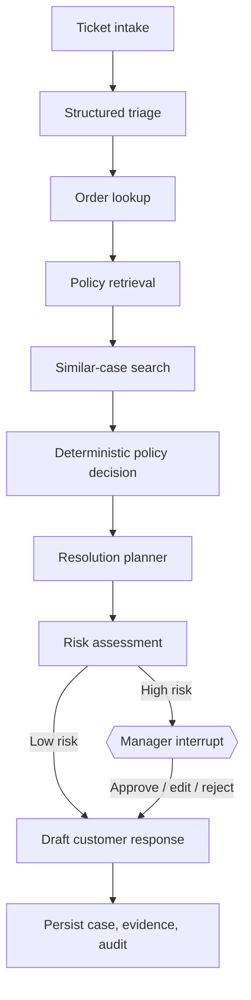
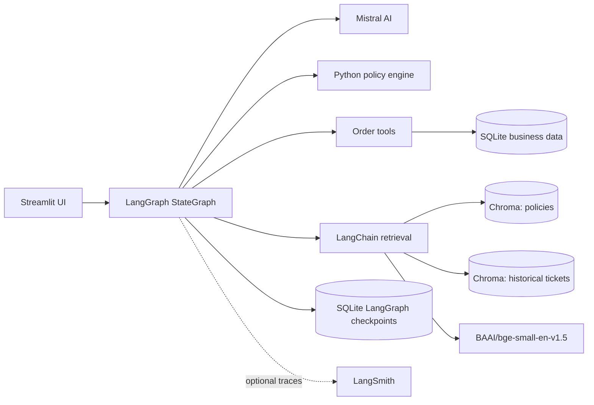
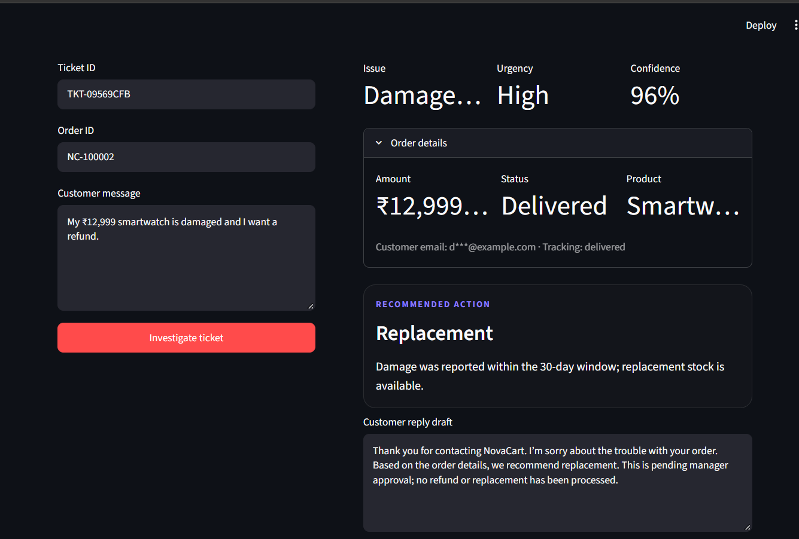
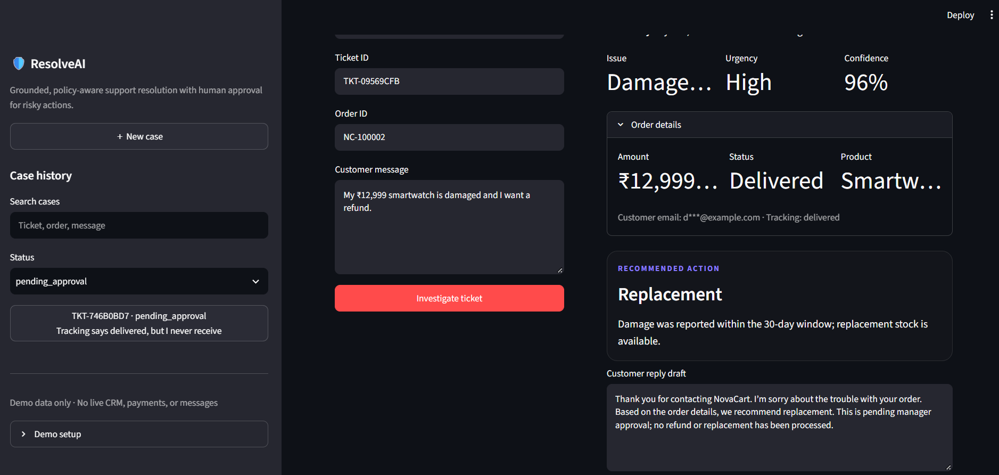

# ResolveAI — Agentic Customer Support Resolution Copilot

> **Grounded, policy-aware support resolution with human approval for risky actions.**

ResolveAI is a portfolio-ready, domain-specific agentic RAG application for synthetic e-commerce support operations. It investigates a ticket, verifies SQLite order facts, retrieves NovaCart policy evidence, compares non-binding historical cases, applies deterministic eligibility rules, drafts a safe response, and pauses high-risk cases for manager approval.

## Problem statement

Support agents lose time moving between order systems, policy documents, and old tickets. A language model alone can also hallucinate order facts or approve an unsafe exception. ResolveAI separates language tasks from business controls: Mistral handles structured triage and drafting, while Python policy rules decide eligibility and LangGraph enforces the workflow.

## Solution overview

- **Agentic investigation:** explicit LangGraph nodes and conditional approval routing.
- **Grounded RAG:** separate persistent Chroma collections for official policies and resolved cases.
- **Deterministic controls:** Python rules decide return windows, delivery-state handling, high-value approval, and exceptions.
- **Human in the loop:** LangGraph `interrupt()` pauses high-risk cases; manager approve, reject, or edit-and-approve decisions resume the workflow and are persisted in SQLite.
- **Durable case history:** business records and audit logs live in SQLite; LangGraph state uses `SqliteSaver`.
- **Safe simulation:** every resolution, escalation, and customer message is only a draft.

## Product workflow



## Architecture



## Screenshots

### Low-risk resolution

A low-value damaged-product ticket is resolved without manager interruption. The agent retrieves order facts and policy evidence, applies deterministic eligibility rules, and saves a customer-safe resolution draft.


### High-risk manager approval

A high-value ₹12,999 damaged-product case pauses for manager review before a draft can be finalized.



### Approved resolution

After manager approval, ResolveAI resumes the LangGraph workflow, saves the resolution draft in SQLite, and keeps a durable audit trail.



### Evidence and activity

Policy citations, historical-case context, and safe agent activity make each recommendation inspectable.


## Features

- Structured Pydantic triage with supported issue taxonomy.
- Synthetic order lookup with masked email addresses.
- Policy retrieval with source, category, version, section/page, chunk ID, and updated date.
- Similar resolved-ticket retrieval explicitly marked non-binding.
- Deterministic damaged-item, refund, delay, delivery-dispute, and wrong-item rules.
- Mandatory review for values above ₹10,000, policy exceptions, chargebacks, legal/fraud/security signals, suspicious instructions, and low confidence.
- Manager approve, reject, and edit-and-approve paths.
- Persistent tickets, messages, resolution drafts, approvals, audit logs, and thread metadata.
- Markdown, TXT, and PDF exports.
- Graceful demo mode without a Mistral key or populated Chroma index.
- Local evaluation harness and pytest suite.
- Optional LangSmith tracing.

## Tools and why they exist

| Tool | Purpose |
|---|---|
| `search_knowledge_base` | Retrieves official policy evidence; avoids generic or web-based answers. |
| `get_order_details` | Returns verified synthetic order facts and masks PII. |
| `check_policy_eligibility` | Applies binding Python business rules rather than LLM-only judgment. |
| `search_similar_resolved_tickets` | Offers non-binding precedent for consistency. |
| `create_escalation_draft` | Saves an escalation draft locally; never sends it. |
| `save_resolution_draft` | Persists the recommended response and citations; never contacts a customer. |
| `calculate_refund_amount` | Performs a narrow deterministic amount calculation when needed. |

No unrestricted web search, real payment action, CRM mutation, or email-sending tool is present.

## Technology stack

- Python 3.11+
- Streamlit
- LangGraph `StateGraph`, interrupts, `Command`, and SQLite checkpointer
- LangChain and `langchain-mistralai`
- Mistral `mistral-small-latest`
- ChromaDB via `langchain-chroma`
- Hugging Face `BAAI/bge-small-en-v1.5`
- SQLite
- Pydantic v2
- fpdf2
- pytest
- LangSmith, optional

The dependency ranges in `requirements.txt` target the LangChain 0.3 / LangGraph 0.3 generation and related integration packages. If adopting newer major versions, review their migration notes, particularly structured output, Chroma, checkpointer, and interrupt APIs.

## Repository structure

```text
resolveai/
├── app.py
├── backend/
│   ├── __init__.py
│   ├── config.py
│   ├── database.py
│   ├── models.py
│   ├── graph.py
│   ├── agent_nodes.py
│   ├── tools.py
│   ├── policy_engine.py
│   ├── rag.py
│   ├── prompts.py
│   ├── ticket_service.py
│   ├── export_service.py
│   ├── security.py
│   ├── seed_data.py
│   └── evaluate.py
├── data/
│   ├── policies/                 # Five NovaCart policies
│   ├── resolved_tickets/         # 32 synthetic historical cases
│   └── evaluation/               # 32 local evaluation cases
├── chroma_db/.gitkeep
├── storage/.gitkeep
├── tests/
├── requirements.txt
├── .env.example
├── .gitignore
├── Dockerfile
├── docker-compose.yml
├── README.md
└── LICENSE
```

## Setup

### 1. Create an environment

```bash
python -m venv .venv
```

**Windows PowerShell:**

```powershell
.\.venv\Scripts\Activate.ps1
```

**macOS/Linux:**

```bash
source .venv/bin/activate
```

Then install dependencies:

```bash
python -m pip install --upgrade pip
pip install -r requirements.txt
```

> Optional: `uv venv --python 3.11` and `uv pip install -r requirements.txt` can be used for faster local setup.

The first embedding-model run downloads `BAAI/bge-small-en-v1.5`; allow network access and local model-cache space.

### 2. Configure environment variables

```bash
cp .env.example .env
p install -r requirements.txt
``````

| Variable | Required | Description |
|---|---:|---|
| `MISTRAL_API_KEY` | For LLM mode | Mistral API key. Without it, safe deterministic demo fallbacks run. |
| `MISTRAL_MODEL` | No | Defaults to `mistral-small-latest`. |
| `DATABASE_PATH` | No | SQLite business/checkpoint database path. |
| `CHROMA_PERSIST_DIR` | No | Local persistent Chroma directory. |
| `EMBEDDING_MODEL` | No | Defaults to `BAAI/bge-small-en-v1.5`. |
| `LANGCHAIN_TRACING_V2` | No | Set `true` to enable LangSmith. |
| `LANGCHAIN_API_KEY` | For tracing | LangSmith API key. |
| `LANGCHAIN_PROJECT` | No | Trace project name. |
| `LANGCHAIN_ENDPOINT` | No | LangSmith endpoint. |

Never commit `.env`.

## Seed demo data

```bash
python -m backend.seed_data --count 100 --reset
```

This creates at least 100 synthetic orders, including stable test orders `NC-100001` through `NC-100008`.

## Ingest or rebuild vector stores

```bash
python -m backend.seed_data --count 100 --reset --ingest
```

`--ingest` embeds five policy documents into `novacart_policies` and 32 historical cases into `novacart_resolved_tickets`. `--reset` deletes the local Chroma directory and resets demo database rows. If embeddings cannot initialize, the app still uses a local lexical fallback over the same synthetic files.

## Run locally

```bash
streamlit run app.py
```

Open `http://localhost:8501`. Try `NC-100001` for a low-value damaged replacement and `NC-100002` for a high-value manager interrupt.

## Tests

```bash
pytest -q
```

Tests cover deterministic policy decisions, order lookup, PII masking, prompt-injection detection, and approval-routing regression cases.

The approval-routing tests verify that:

- Low-value damaged-product cases proceed directly to a response draft.
- Low-value in-transit orders do not trigger unnecessary manager review.
- High-value orders above ₹10,000 require manager approval.
- Out-of-window refund exceptions require approval.
- High-value delivered-not-received cases require approval.
- Invalid approval-state values such as `"False"`, `1`, `None`, or tuple values are rejected rather than routed using Python truthiness.

## Local evaluation

```bash
python -m backend.evaluate
```

The evaluator reads `data/evaluation/support_eval_dataset.json` and prints:

- policy decision accuracy;
- issue classification accuracy;
- escalation recall;
- citation/source presence rate;
- tool error rate;
- average latency.

It does **not** contain fabricated benchmark scores. Run it in your environment, inspect mismatches, and add only measured results to your portfolio. The lightweight evaluator uses deterministic classification and policy checks so it remains available without LangSmith or an API key.


## Validation performed

The local implementation was validated using:

- Automated pytest coverage for policy rules, database lookup, security helpers, and strict LangGraph approval routing.
- A 32-case synthetic evaluation set for policy decisions, issue classification, escalation behavior, citation/source presence, and tool errors.
- Manual end-to-end workflow checks for:
  - Low-value damaged product → response draft without approval.
  - Low-value in-transit order → delivery update without approval.
  - High-value damaged product → LangGraph manager interrupt → approved draft persisted in SQLite.
  - Refund request outside the standard return window → exception review workflow.

The synthetic evaluation harness is designed for controlled demo validation and should not be interpreted as a claim of real-world production accuracy.

## LangSmith tracing

Set these values in `.env`:

```dotenv
LANGCHAIN_TRACING_V2=true
LANGCHAIN_ENDPOINT=https://api.smith.langchain.com
LANGCHAIN_API_KEY=your-key
LANGCHAIN_PROJECT=resolveai-support-copilot
```

LangChain/LangGraph calls then appear in the selected project. Traces help inspect node routing, retrieval, tool errors, and latency. ResolveAI masks email in normal order output and avoids intentionally adding secrets or unredacted profiles to audit logs. Review your organisation’s data policy before tracing any non-demo content.

For dataset-based evaluation in LangSmith, create a dataset from the JSON cases, map `customer_message` and `order_id` as inputs, run the compiled graph with a unique `thread_id` per example, and register evaluators for action, classification, escalation, and source presence. Keep the local command above as the offline baseline.

## Run with Docker

### Prerequisites

- Docker Desktop installed and running
- Docker Compose v2

### Build and start the application

```bash
docker compose up --build
```

After the container starts, open:

```text
http://localhost:8502
```

The application runs on Streamlit port `8501` inside the Docker container. Docker maps host port `8502` to container port `8501`:

```yaml
ports:
  - "8502:8501"
```

### Stop the application

Press `Ctrl + C` in the terminal that is running Docker Compose, then run:

```bash
docker compose down
```

### Run in the background

```bash
docker compose up -d
```

View logs:

```bash
docker compose logs -f
```

Stop the background container:

```bash
docker compose down
```

## Safety and limitations

- Retrieved documents and customer messages are treated as untrusted data.
- Basic injection patterns are flagged; they are not executed.
- Deterministic policy code, not an LLM, controls core eligibility.
- Full emails are masked in order-tool output and logs are redacted.
- All financial, escalation, CRM, and customer-message actions are drafts.
- Approval is required for high-value and risk-triggered cases.
- Lexical demo retrieval is less semantically capable than the embedded Chroma index.
- Rules are illustrative, not legal advice or a production commerce policy.
- A production system would need authentication/RBAC, database migrations, encrypted secrets, row-level access controls, robust queues, monitoring, retention policies, and integration-level idempotency.
- Recommendation metadata may retain its initial `pending_approval` value in an export after a manager approval, while the top-level case status and saved customer-response draft reflect the final resolved workflow state.

## Synthetic-data disclaimer

**This project uses entirely synthetic order, customer, policy, and ticket data for portfolio demonstration. It does not connect to a real CRM, payment system, or live support channel, and it does not automatically process refunds or send customer messages.**

## Future improvements

- Parallel fan-out investigation with deterministic join semantics.
- Production-grade PostgreSQL and object storage.
- Role-based manager authentication and signed approvals.
- Reranking, hybrid retrieval, and citation faithfulness scoring.
- LangSmith CI evaluations and regression gates.
- Multilingual support with policy-safe locale templates.
- Carrier/CRM connectors restricted to read-only or approval-gated scopes.

## Resume-ready project description

> “Built an agentic RAG customer-support copilot using LangGraph that investigates support tickets through policy retrieval, SQLite order lookup, deterministic eligibility rules, and similarity search over historical cases. Added citation-backed recommendations, persistent case history, LangGraph interrupt-based manager approval for high-risk actions, and LangSmith tracing/evaluation support.”

## Exact command sequence

```bash
cd resolveai
python -m venv .venv
source .venv/bin/activate
pip install -r requirements.txt
cp .env.example .env
python -m backend.seed_data --count 100 --reset
python -m backend.seed_data --count 100 --ingest
pytest -q
python -m backend.evaluate
streamlit run app.py
```

## Author

**Sonu Kumar**  
Final-year B.Tech Computer Science student | Aspiring AI/ML Engineer

Built ResolveAI independently as a portfolio project to demonstrate practical AI engineering with agentic RAG, deterministic business controls, human-in-the-loop workflows, persistent state, evaluation, and deployment-ready architecture.

- GitHub: [Sonu0701](https://github.com/Sonu0701)
- LinkedIn: [Add your LinkedIn profile URL here](https://www.linkedin.com/in/sonu-kumar-ai/)


## 📄 License

This project is licensed under the MIT License. See [LICENSE](LICENSE) for details.

---

<div align="center">

**If this project helped you or impressed you, please give it a ⭐**
It genuinely helps with visibility and motivates further development!

</div>
